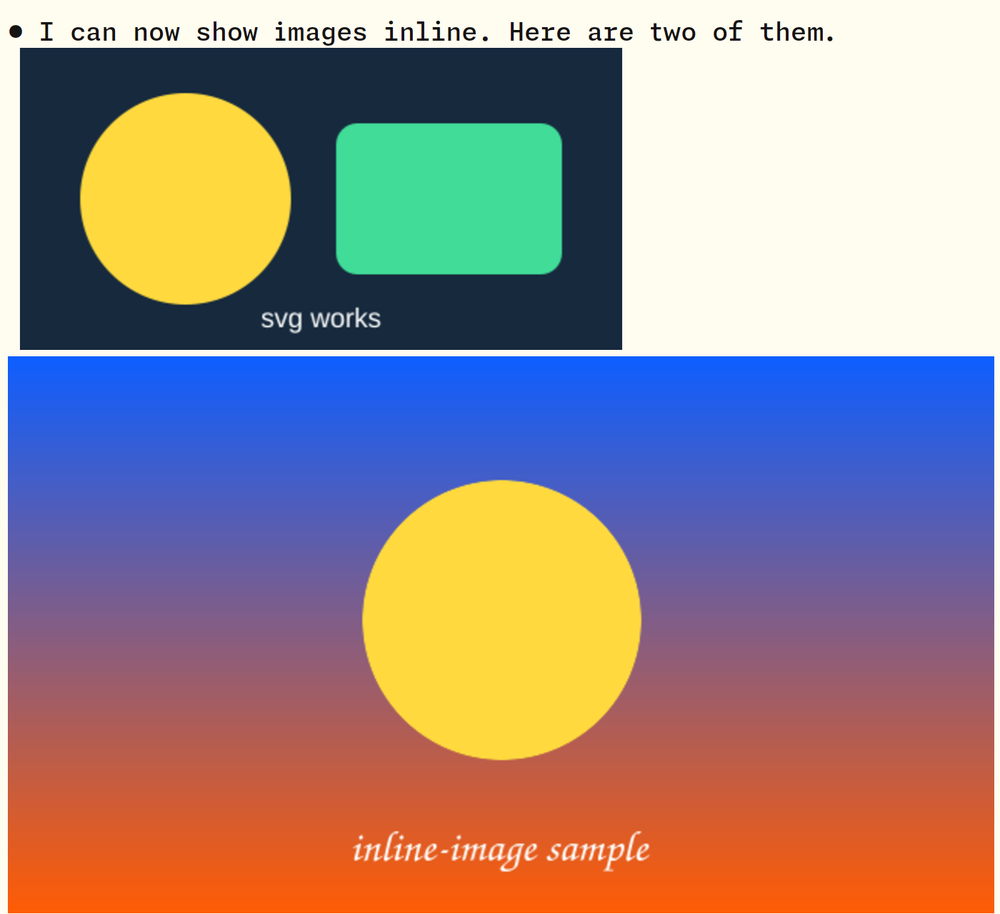

# inline-image

A Claude Code mod that draws images **inline in Claude's replies**. When a reply contains
``, the picture appears right under the text, in the terminal.



Claude Code's built-in tools only report "Read image (3.7KB)". This mod adds the missing piece: Claude can *show* you a
screenshot, a chart it just rendered, a diagram or a photo, without you leaving the terminal.

- **Any format your ImageMagick reads:** PNG, JPEG, WebP, GIF (first frame), SVG, AVIF, TIFF, BMP and, where your build has the delegates, HEIC and PDF (first page).
- **Sized for your pane:** keeps the picture's aspect ratio, fits the pane width and a row limit, shrinks big images to fit.
- **No hairlines between rows:** optionally scales each image to the exact pixel size of its cell box (see [Hairlines](#hairlines-between-rows)).
- **Safe by default:** only local files. Web URLs are off unless you opt in.
- **Falls back gracefully:** a missing file, an unreadable format or a terminal without image support shows a dim note, never an error.

## Install

At the prompt of a terminal Claude Code session:

```
/plugin install inline-image --marketplace adhikasp/claude-inline-image
```

Answer `y` to add the marketplace, then pick the user scope. From a shell: `claude plugin install inline-image --marketplace adhikasp/claude-inline-image`.

You also need an image-capable terminal and, for the best results, ImageMagick:

```bash
# Arch / Omarchy
sudo pacman -S imagemagick
# macOS
brew install imagemagick
# Debian / Ubuntu
sudo apt install imagemagick
```

Without ImageMagick the mod still shows PNG files up to about 1.9 MB as they are.

## Use it

Ask Claude to show you something, or tell it once how: *"When you want to show me an image, write it as
`` on its own line."* Put that sentence in your `CLAUDE.md` and it holds for every session.

Paths can be absolute, relative to the working directory, `~/…`, or `file://…`. Put a path with spaces in angle
brackets: ``. Up to 4 images per message are drawn (`maxImages`); the link text is
removed from the reply and replaced by the picture.

## Which terminals work

The mod draws with Claude Code's terminal `Image` element, which uses the Kitty graphics protocol (Unicode
placeholders) or iTerm2 inline images. Claude Code switches this on by itself in:

- **kitty** 0.28+ and **Ghostty**
- **iTerm2** 3.5+
- **tmux** 3.3+ inside one of the above, with `set -g allow-passthrough on` and `set -g focus-events on`

A terminal that speaks the Kitty protocol but that Claude Code does not recognise (for example the
Herdr desktop app) needs one environment variable, set before Claude starts:

```bash
export CLAUDE_CODE_FORCE_TERMINAL_IMAGES=1
```

or, to apply it to every session, in `~/.claude/settings.json`:

```json
{ "env": { "CLAUDE_CODE_FORCE_TERMINAL_IMAGES": "1" } }
```

Elsewhere the mod shows the image's alt text in dim type and nothing breaks.

## Options

Set them in the plugin's config menu (`/plugin`, then inline-image) or in `settings.json` under
`pluginConfigs["inline-image@claude-inline-image"].options`.

| Option | Default | What it does |
| --- | --- | --- |
| `maxColumns` | 80 | Widest an image may be, in terminal columns (also limited by the pane width) |
| `maxRows` | 24 | Tallest an image may be, in rows |
| `maxImages` | 4 | Images drawn per message; extra links stay as text |
| `cellAspect` | 2.1 | How much taller a cell is than wide. Only matters when the cell pixel size is unknown |
| `cellWidthPx`, `cellHeightPx` | 0 | Pixel size of one cell, for [exact scaling](#hairlines-between-rows). 0 means detect it |
| `allowRemote` | off | Also fetch `http(s)://` images with `curl`. Off by default, because a reply could otherwise make your machine request any URL |

## Hairlines between rows

Some terminals draw an image as one slice per text row and leave a faint line (about 1 px, a few percent darker) at
every row boundary. It happens when the picture is resampled to fit its box. The cure is to hand the terminal a raster
that is **exactly** as many pixels as the box, so nothing is resampled.

For that the mod needs the size of one cell in pixels:

1. **Detected** from the terminal's window size, when it reports pixels (kitty, Ghostty, WezTerm, foot and others do).
2. **`INLINE_IMAGE_CELL_PX=22x47`** (width × height), an environment variable, for terminals that do not.
3. **`cellWidthPx` / `cellHeightPx`**, the same as options.

To measure: take a screenshot and divide the pane's width in pixels by its number of columns, and the height of one
text row in pixels. On a HiDPI screen use device pixels, not CSS pixels. When a photo is too large to fit exactly (the
2 MiB payload limit) the mod shrinks the box until it does, so photos stay seam-free too.

## How it works

A `ui.render` hook on `AssistantMessage` finds the image links in each reply, converts every picture to a PNG that fits
(`magick`, with `convert`, `gm`, `ffmpeg` and `rsvg-convert` as fallbacks), sizes a box of terminal cells to the
picture's aspect, and draws it with the terminal `Image` element under the reply text. Conversions are cached for the
session and the temporary files are removed when it ends. Nothing is sent anywhere, and the stored transcript is
unchanged (ctrl+o shows the original text).

## Limits

- Terminal only. The desktop app, VS Code and mobile surfaces do not have an `Image` element, so the reply is shown as it is.
- Animations show their first frame; PDFs their first page.
- Each image is at most 2 MiB as PNG after scaling.
- `~/` expands with `$HOME`; other users' homes (`~name/`) do not.

## Develop

```bash
git clone https://github.com/adhikasp/claude-inline-image && cd claude-inline-image
claude --plugin-dir .            # hot-reloads when files change
claude plugin validate .
claude plugin test .             # tests/*.test.tsx
tsc -p .                        # the types are laid in .claude-plugin/types the first time the plugin loads
```

## License

[MIT](LICENSE)
